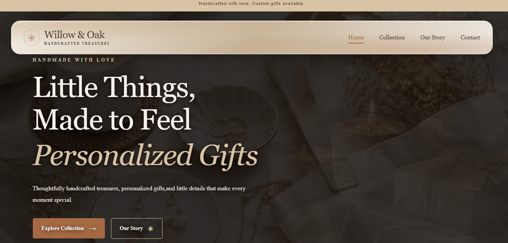

# Willow & Oak 🌿

## Handmade with Love

Willow & Oak is a responsive website designed for a handmade products brand. It showcases handcrafted jewelry, handmade candles, and personalized gifts through an elegant and user-friendly interface.

## ✨ Features

Elegant Design: A warm, natural aesthetic with a soft, earthy color palette.

Product Categories: Separate collections for jewelry, candles, and personalized gifts.

Interactive Popup Galleries: Explore product images in a popup gallery without leaving the page.

Responsive Layout: Designed to provide a comfortable browsing experience across desktop and mobile screens.

Smooth Interactions: Includes gallery open and close functionality, background overlay, and Escape-key support.

Custom Typography: Uses Playfair Display for headings and Inter for body text.

## 🛠️ Technologies Used

HTML5

CSS3

JavaScript

## ScreenShots

